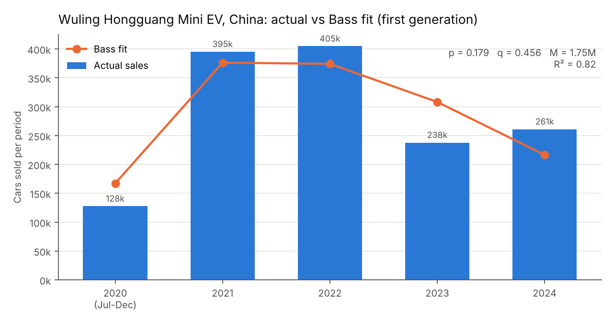
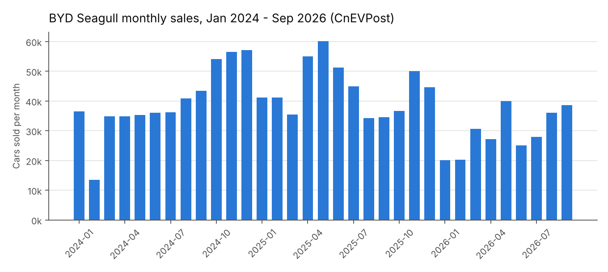
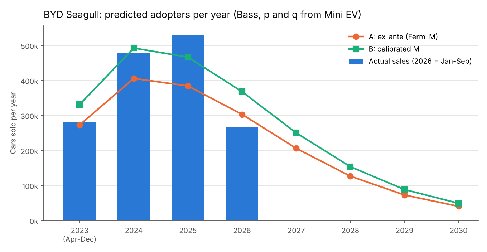
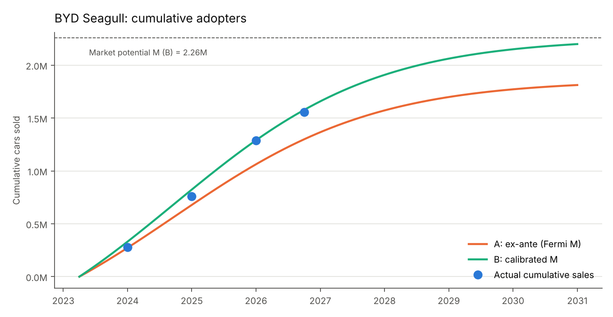

# 1. The chosen innovation: BYD Seagull

**TIME Best Inventions 2025 entry:** [BYD Seagull — "An affordable EV"](https://time.com/collections/best-inventions-2025/7318540/byd-seagull/) (category: Transportation).

The BYD Seagull is a small battery-electric (BEV) hatchback. It is sold as the *Seagull* in China, the *Dolphin Mini* in Latin America, the *Dolphin Surf* in Europe and South Africa, and the *Atto 1* in parts of Asia and Oceania [16]. TIME describes it as BYD's cheapest car: RMB 73,800 (about US$10,300) at launch, a 30 kWh battery, a 55 kW motor and about 190 miles of range [1]. It was presented on 27 April 2023 and deliveries in China started right after [16]. The one-millionth car was built in June 2025 [13].

Why it is an innovation: the Seagull is not a new *kind* of product (electric cars already existed), but it is a new *price point* for a real, four-seat, highway-capable BEV. It made an electric car cheaper than many petrol cars of the same size, which is why TIME put it on the list.

# 2. A similar innovation from the past: Wuling Hongguang Mini EV

The look-alike innovation is the **Wuling Hongguang Mini EV**, launched by SAIC-GM-Wuling in China in July 2020 [5, 6].

**Why these two are alike.** Both cars were built to answer the same question: *can an electric car be cheap enough for ordinary families?* Both are Chinese, both sit in the smallest car classes (A00/A0), both use cheap lithium-iron-phosphate batteries, and both are sold mainly as city cars. Both became famous almost overnight: the Mini EV was China's best-selling EV in 2021 and 2022 and at times outsold the Tesla Model 3 worldwide [6, 7], and the Seagull became China's best-selling car in several months of 2024 [9, 10]. In market terms they are direct neighbours: in December 2024 the Seagull (57,087 units) and the Mini EV (44,903 units) were the two best-selling small EVs in China [10, 17]. CarNewsChina even explains the Mini EV's 2023 sales drop by noting that buyers could "get an actual car like BYD Seagull" for a slightly higher price [7].

**How they differ.** The Seagull is a bigger, more "complete" car (longer range, fast charging, four doors, driver assistance), while the Mini EV is a tiny two-door micro-car with about 120–200 km of range. So the Seagull is the *next step* of the same idea: the Mini EV proved that cheap EVs sell in very large numbers, and the Seagull took that idea to a more practical car. Because the two products serve the same buyers, with the same price logic, in the same country, the speed at which people adopted the Mini EV (its *p* and *q*) is a good guess for how fast people adopt the Seagull.

# 3. Historical data

Statista requires the AUA network, so the data come from other reliable public sources (the homework allows "another reliable resource").

| Year | Mini EV sales in China | Source |
|---|---:|---|
| 2020 (Jul–Dec) | 127,651 | InsideEVs, Jan 2021 [6]; Wikipedia [5] |
| 2021 | 395,451 | CPCA via InsideEVs, Jan 2022 [19] |
| 2022 | 404,823 | Wikipedia sales table [5] (CPCA wholesale: 554,067 [8]) |
| 2023 | 237,863 | Wikipedia [5]; CarNewsChina, Aug 2025 [7] |
| 2024 | 261,141 | Wikipedia [5] |
| 2025 | 424,983 | Wikipedia [5] — *second generation, not used* |

*File: `data/hongguang_mini_ev_annual_sales.csv`.*

Notes on the data:

* The sum 2020–2024 is 1.43 million, which matches SGMW's statement that cumulative sales passed 1.4 million in 2024 [7], so the series is internally consistent.
* For 2022 two numbers exist: 404,823 (main series) and 554,067 (CPCA wholesale for all Mini EV variants, Gasgoo [8]). I use the first one as the main series and the second one as a **sensitivity check**.
* The fit uses the **first-generation life cycle 2020–2024 only**. In February 2025 a completely new second-generation Mini EV was launched [5]; it is a new product with its own diffusion curve, so mixing it in would be wrong.

As a second, category-level check I also use **China battery-electric car sales 2010–2025** from the IEA *Global EV Outlook 2026*, published by Our World in Data [14] (`data/china_ev_market_iea.csv`). BEV sales = electric-car sales × BEV share of electric cars.

# 4. Estimating the Bass model parameters

**Model.** In the Bass (1969) model [3] the share of the market that has adopted by time *t* is

$$F(t)=\frac{1-e^{-(p+q)t}}{1+\frac{q}{p}e^{-(p+q)t}},$$

and the number of adopters in a period $[t_0,t_1]$ is $M\,[F(t_1)-F(t_0)]$. Here *p* is the coefficient of innovation (people who buy because of advertising and media), *q* is the coefficient of imitation (people who buy because others did), and *M* is the market potential.

**Method.** Time is measured in years since launch (1 July 2020). The first period lasts only 6 months, so the period edges are 0, 0.5, 1.5, 2.5, 3.5, 4.5. I estimate *p*, *q* and *M* by **non-linear least squares** (`scipy.optimize.curve_fit`) on the yearly sales, trying 16 starting points and keeping the best one (`fit_lookalike.py`, `helper_functions.py`).

| Series | p | q | M | R² | Peak (years after launch) |
|---|---:|---:|---:|---:|---:|
| **Mini EV, main series** | **0.179** (s.e. 0.050) | **0.456** (s.e. 0.352) | **1.75 M** (s.e. 0.39 M) | 0.82 | 1.47 |
| Mini EV, CPCA 2022 figure | 0.137 (0.071) | 0.911 (0.460) | 1.67 M (0.33 M) | 0.76 | 1.80 |
| China BEV category, 2010–2025 | 0.0001 | 0.517 | (63 M, not reliable) | 0.99 | 16.1 |

*File: `data/bass_params_lookalike.csv`.*

{width=88%}

**How to read the results.**

* For the Mini EV, **p = 0.179 and q = 0.456**. Both are larger than the average values in the meta-analysis of Sultan, Farley & Lehmann (1990), p ≈ 0.03 and q ≈ 0.38 [4]. A high *p* makes sense: the Mini EV entered a category people already knew (electric cars), it got huge media attention, and it was cheap, so many people bought it "on their own" right from the start instead of waiting for others. The model puts the sales peak about 1.5 years after launch (end of 2021–2022), which matches the data.
* *q* is not estimated very precisely (only 5 yearly points), and with the alternative 2022 number *q* rises to 0.91. Both fits give almost the same market potential (1.67–1.75 M), so *M* is quite stable; the split between *p* and *q* is less certain. I keep the main series and show the effect of the alternative below.
* The **category** fit (all BEVs in China) has a tiny *p* and *q* ≈ 0.52: the whole technology spread mostly by imitation over 15 years. Its *M* is not reliable because the category has not peaked yet. It is useful only as a check that *q* ≈ 0.46–0.52 is a reasonable imitation rate for EVs in China. For a *single car model*, the product-level Mini EV parameters are the right ones to use.

# 5. Scope: worldwide

I model **worldwide** Seagull sales. Reasons:

1. The Seagull is a global product. It is sold in more than 15 countries under four names (Seagull, Dolphin Mini, Dolphin Surf, Atto 1) [16], and TIME's entry itself mentions its launch "in 15 European markets" [1].
2. Exports are a large and growing part of sales. Using the country table on Wikipedia [16], the non-China share was about 5% in 2024 (453,593 of 479,294) but about 41% in 2025 (310,956 in China out of 529,537). A China-only model would miss a large part of the adopters.
3. The best data that exist are BYD's **global wholesale** sales per month, compiled by CnEVPost from BYD/CPCA reports [11, 12]. Reliable country-by-country monthly data do not exist for most markets.

China is still the core market, so using *p* and *q* from a Chinese look-alike is reasonable.

# 6. Predicting the diffusion of the BYD Seagull

**Observed sales** (`data/byd_seagull_annual_sales.csv`, `data/byd_seagull_monthly_sales.csv`): 280,217 (Apr–Dec 2023) [9]; 479,294 (2024) [10, 12]; 529,537 (2025) [11]; 265,901 (Jan–Sep 2026) [12]. The monthly CnEVPost numbers add up exactly to the reported yearly totals. Cumulative sales by September 2026 are 1.55 million. Sales are now falling (−33% in Jan–Sep 2026) and BYD launches a second-generation Seagull on 20 October 2026 [12, 18].

{width=88%}

I use the Mini EV's *p* = 0.179 and *q* = 0.456 and build two predictions. Time is measured in years since 1 April 2023.

## 6.1 Prediction A — ex-ante, M from Fermi logic

This is the prediction I could have made at launch, without using any Seagull sales.

| Step | Value | Reasoning / source |
|---|---:|---|
| BEV sales in China, 2024 | 7,037,467 | Inovev [15] |
| × share of small (A-segment) BEVs | 17% → 1.20 M per year | Inovev [15] |
| × Seagull share of small BEVs | 1/3 → 0.40 M per year | Assumption: Seagull is the segment leader [10, 17] |
| × life of the first generation | 3.5 years → 1.39 M | Apr 2023 → new generation Oct 2026 [12] |
| ÷ (1 − export share) | 1 − 0.25 → **M ≈ 1.86 M** | Assumption between ~5% (2024) and ~41% (2025) [16] |

*File: `data/fermi_inputs.csv`, `data/seagull_fermi_M.csv`.*

## 6.2 Prediction B — calibrated M

Here *p* and *q* stay fixed at the look-alike values and only *M* is fitted to the Seagull's own sales (Apr 2023 – Sep 2026) by least squares. This gives **M ≈ 2.26 M**. (With the alternative look-alike *p*, *q* the same method gives M ≈ 1.85 M.)

| Period | Actual | A: ex-ante | B: calibrated |
|---|---:|---:|---:|
| 2023 (Apr–Dec) | 280,217 | 272,843 | 331,168 |
| 2024 | 479,294 | 405,683 | 492,406 |
| 2025 | 529,537 | 384,337 | 466,496 |
| 2026 Jan–Sep | 265,901 | 236,515 | 287,075 |
| **Mean absolute % error** | | **14.1%** | **10.2%** |

The ex-ante prediction A, made only from the look-alike and Fermi logic, is already within about 14% of reality on average, and its *M* (1.86 M) is close to the 1.55 M cars that were actually sold in the first 3.5 years. Prediction B fits better: it puts cumulative sales at the end of September 2026 at 1.58 M, against 1.55 M actual.

{width=92%}

{width=92%}

# 7. Estimated number of adopters by period

Using prediction B (p = 0.179, q = 0.456, M = 2.26 M), one "adopter" = one first-generation Seagull sold:

| Period | New adopters | Cumulative adopters | Share of M reached |
|---|---:|---:|---:|
| 2023 (Apr–Dec) | 331,168 | 331,168 | 14.7% |
| 2024 | 492,406 | 823,574 | 36.5% |
| 2025 | 466,496 | 1,290,070 | 57.2% |
| 2026 | 367,826 | 1,657,896 | 73.5% |
| 2027 | 250,260 | 1,908,157 | 84.6% |
| 2028 | 153,660 | 2,061,816 | 91.4% |
| 2029 | 88,474 | 2,150,290 | 95.3% |
| 2030 | 49,066 | 2,199,356 | 97.5% |

*Files: `data/seagull_forecast_annual.csv` (also has prediction A) and*
*`data/seagull_forecast_quarterly.csv` (quarterly version).*

Main points:

* The model puts the **peak of adoption about 1.5 years after launch (late 2024)**. In the real data, the highest months were Dec 2024 (57,087) and May 2025 (60,131), so the timing is right.
* About **three quarters of the market potential is reached by the end of 2026**, and 95% by 2029.
* The model expects about 102,000 more first-generation Seagulls in Oct–Dec 2026 (367,826 − 265,901). In practice, the second-generation Seagull (launch 20 Oct 2026) will take over many of these remaining buyers. So the 2027–2030 numbers should be read as **demand for a small, cheap BYD EV** that will be shared between the old and new generations, not as sales of the old model alone.

# 8. Limitations

* The look-alike series has only 5 yearly points, so *q* has a wide standard error; the 2022 data disagreement changes *q* (0.46 vs 0.91) but not *M* much.
* Sales are **wholesale** (shipped by BYD), not retail registrations. Some cars sit in dealer stock or are exported later.
* The Bass model has no price, competition or policy variables. Price cuts (2024), new rivals such as the Geely Xingyuan/EX2 (2025–2026) [18], and the replacement by a second generation all shift sales in ways the model cannot see.
* Two Fermi inputs (Seagull's 1/3 share of small BEVs and the 25% export share) are assumptions; changing them by ±20% changes *M* by about ±20%.

# References

1. TIME (2025). *BYD Seagull — The Best Inventions of 2025*. <https://time.com/collections/best-inventions-2025/7318540/byd-seagull/>
2. TIME (2025). *The Best Inventions of 2025*. <https://time.com/collections/best-inventions-2025/>
3. Bass, F. M. (1969). A new product growth for model consumer durables. *Management Science*, 15(5), 215–227. <https://doi.org/10.1287/mnsc.15.5.215>
4. Sultan, F., Farley, J. U., & Lehmann, D. R. (1990). A meta-analysis of applications of diffusion models. *Journal of Marketing Research*, 27(1), 70–77. <https://doi.org/10.1177/002224379002700107>
5. Wikipedia. *Wuling Hongguang Mini EV* (sales table, accessed 19 Oct 2026). <https://en.wikipedia.org/wiki/Wuling_Hongguang_Mini_EV>
6. InsideEVs (2021). *China: Wuling Hong Guang MINI EV amazes with 35,000+ sales in December*. <https://insideevs.com/news/464529/china-wuling-hong-guang-mini-ev-december/>
7. CarNewsChina (2025, Aug 11). *1.7 millionth Wuling Hongguang Mini EV rolled off production line in China*. <https://carnewschina.com/2025/08/11/1-7-millionth-wuling-hongguang-mini-ev-rolled-off-production-line-in-china/>; and CarNewsChina (2023, May 23). *Wuling Mini EV April sales reveal the reason for a massive price cut*. <https://carnewschina.com/2023/05/23/wuling-mini-ev-april-sales-reveal-the-reason-for-a-massive-price-cut/>
8. Gasgoo (2023). *December 2022 sales ranking of A00 sedans/cars* (CPCA data). <https://autonews.gasgoo.com/sales/article/69739.html>
9. Gasgoo (2024). *December 2023 sales ranking of sedans/cars* (CPCA data; Seagull YTD 280,217). <https://autonews.gasgoo.com/sales/article/72648.html>
10. Gasgoo (2025). *December 2024 auto sales ranking of models from China's brands* (Seagull 57,087; YTD 479,294). <https://autonews.gasgoo.com/sales/article/75787.html>
11. CnEVPost (2026, Jan 3). *BYD Dec sales breakdown* (Seagull 2025: 529,537). <https://cnevpost.com/2026/01/03/byd-dec-2025-sales-breakdown/>
12. CnEVPost (2026, Oct 14). *BYD to launch second-gen Seagull on October 20* (monthly sales 2024–2026). <https://cnevpost.com/2026/10/14/byd-launch-2nd-gen-seagull-oct-20/>
13. CnEVPost (2025, Jun 30). *BYD Seagull hits 1 million units produced*. <https://cnevpost.com/2025/06/30/byd-seagull-1-million-produced/>
14. IEA (2026). *Global EV Outlook 2026*, via Ritchie, H. (2024). *Tracking global data on electric vehicles*. Our World in Data. <https://ourworldindata.org/electric-car-sales> (charts `electric-car-sales`, `bev-share-new-ev`, `car-sales`).
15. Inovev (2025). *BEV and PHEV sales by segment in Europe and China in 2024*. <https://inovev.com/index.php/en/market-analyses/category-blog/21313-2025-06-3>
16. Wikipedia. *BYD Seagull* (accessed 19 Oct 2026). <https://en.wikipedia.org/wiki/BYD_Seagull>
17. Gasgoo (2025). *December 2024 sales ranking of A00 sedans/cars* (Mini EV 44,903; Lumin 14,944). <https://autonews.gasgoo.com/sales/article/75721.html>
18. Automotive World (2026). *BYD supersizes the Seagull as Geely's EX2 eats into sales*. <https://www.automotiveworld.com/news/byd-supersizes-the-seagull-as-geelys-ex2-eats-into-sales/>
19. InsideEVs (2022). *China: Wuling Hong Guang MINI EV sets massive sales record* (CPCA data). <https://insideevs.com/news/560897/china-wuling-hongguang-sales-2021/>
